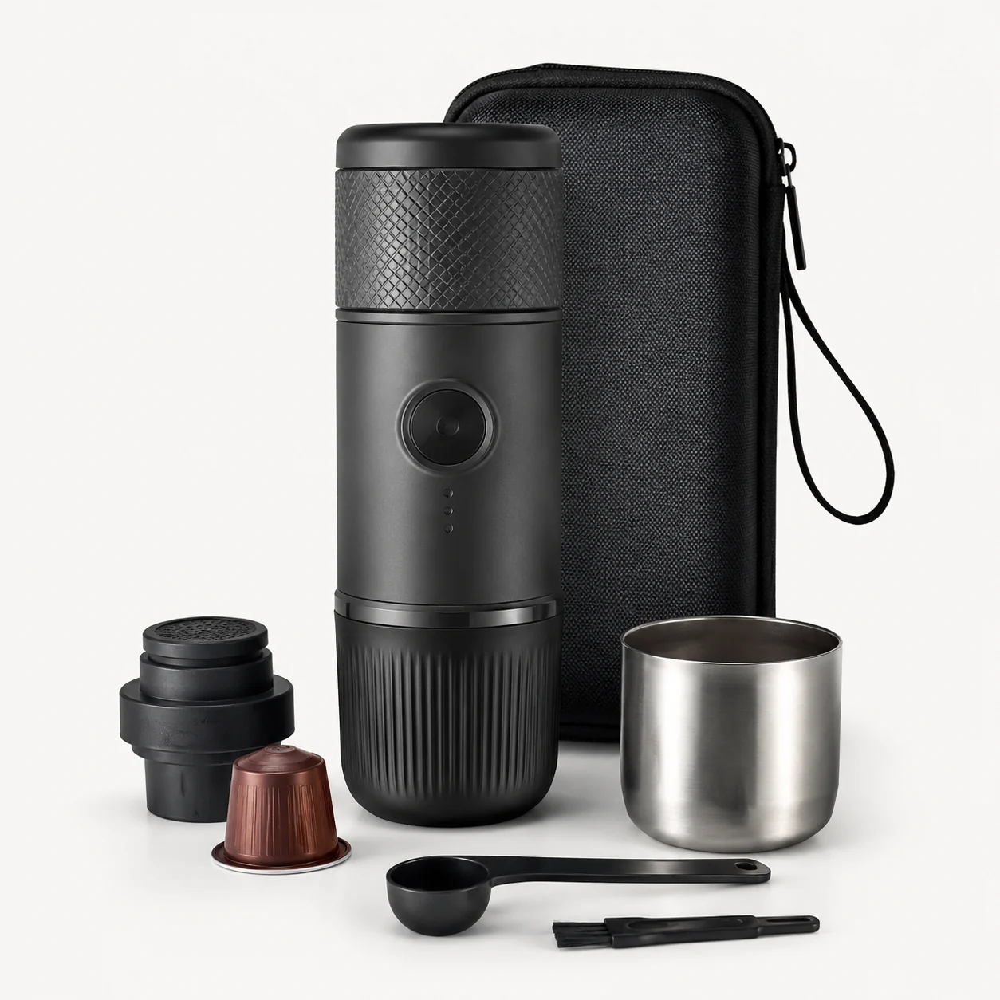
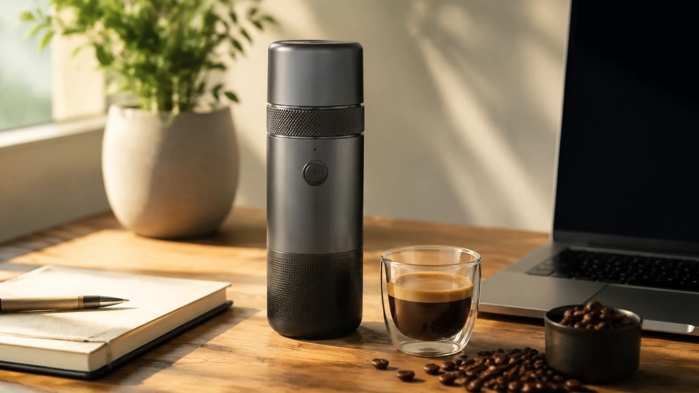

# SuaCanvas · 素画

[中文](README.md) · [日本語](README.ja.md) · **English**

**Turn a product reference into a coordinated set of ecommerce images.**

SuaCanvas is a self-hosted AI workspace for product hero images, lifestyle scenes, feature graphics and detail images. Keep product information, references and results in one project, reuse templates, and extend your workflow with product videos and optional canvases.

## What you can create

| Feature | Purpose |
| --- | --- |
| Product image sets | Organize hero, lifestyle, feature, detail and comparison images around the same product. |
| Product planning and copy | Draft titles, selling points and image briefs before submitting generation tasks. |
| Creative image workflows | Combine prompts, multiple references and templates; refine prompts through creative sessions. |
| Template library | Find image and copy templates by use case, marketplace, category or keyword. |
| Product videos | Prepare scripts, select a configured video model and track generation tasks. |
| Projects and history | Review results, download assets, retry failed images and track credit use or refunds. |
| Administration | Manage users, credits, orders, models, prompts, tasks, costs and audit records. |
| Optional canvases | Integrate Nova Image Studio and Infinite Canvas with separate configuration and their AGPL license obligations. |

**Add product details and references → choose a template → review copy and image briefs → generate → inspect and download.**

Review generated product details, specifications, text and advertising claims before use. Generation quality and available features depend on the configured providers.

## Sample assets

Repository examples showing a portable coffee maker in two contexts:

| Product hero | Lifestyle scene |
| :---: | :---: |
|  |  |

## Project layout

The backend uses Java 17, Spring Boot 3 and MyBatis-Plus. The user and admin websites use Next.js 14, React and TypeScript. PostgreSQL and Redis support data and tasks; files use local storage or MinIO / S3-compatible storage.

| Directory | Contents |
| --- | --- |
| `openImage/` | Backend API, generation, credits, storage and database migrations |
| `openImage-ts/` / `openImage-admin-ts/` | User website and administration website |
| `clients/` | Android and Windows client projects |
| `canvas-lab/` / `third_party/` | Optional canvas integration, source and licenses |
| `scripts/` / `docs/` | Configuration, build, release and source delivery tools and guides |

The project was previously named OpenImage / PicPilot; existing directories, environment variables and some interfaces retain those names.

## Local setup

These steps are for a **new environment**. Install Git, Python 3, Docker Engine or Docker Desktop with Linux containers, and Docker Compose v2. Java, Node.js and the database services run in containers. The first build requires internet access to download images and dependencies.

1. Fetch the source and generate private configuration:

   ```bash
   git clone https://github.com/suakitsu/suacanvas.git
   cd suacanvas
   python scripts/init-local-env.py
   ```

   Use `python3` if that is your Python command. The script creates `.env` with independent random values for database, JWT, object storage and configuration encryption. It refuses to overwrite an existing file. Preserve existing secrets when upgrading a running installation.

2. Build and start the Web platform from the repository root:

   ```bash
   docker compose up -d --build
   docker compose ps
   ```

   Compose starts PostgreSQL, Redis, MinIO, the backend and both websites. The websites wait for backend health; the backend applies database migrations.

3. After the backend is ready, initialize the first administrator in an interactive terminal:

   ```bash
   python scripts/bootstrap-admin.py
   ```

   Enter your own email and password. The tool requires completed migrations and no existing active administrator. It sends the password through standard input to a network-isolated official `httpd:2.4-alpine` tool container for bcrypt hashing; only the hash reaches the database. The tool image may need downloading. No extra Python packages are required.

   The new account starts with zero credits. Sign in to the admin website, configure models and allocate credits as needed. Online administrator registration is disabled; there is no shared default password, and `ADMIN_INVITE_CODE` is not required.

| Service | Default address |
| --- | --- |
| User website | `http://127.0.0.1:13000` |
| Admin website | `http://127.0.0.1:13001` |
| Backend health | `http://127.0.0.1:18080/api/public/ping` |
| MinIO console | `http://127.0.0.1:19001` |

Use your `.env` ports if changed. Inspect logs with `docker compose logs --tail=100 backend user-web admin-web`.

## Connect your services

The base platform does not require a model API key. Real image generation, video, payments and third-party login are disabled by default. Configure your own services before enabling them; provider usage is billed separately.

| Capability | Configuration |
| --- | --- |
| Image generation | `OPENIMAGE_AI_IMAGE_ENABLED=true` plus the matching `PROVIDER`, `BASE_URL`, `KEY` and `MODEL` variables; use a provider compatible with an existing adapter. |
| Copy generation | `OPENIMAGE_AI_TEXT_DEEPSEEK_ENABLED` and the matching `BASE_URL`, `KEY` and `MODEL` variables. |
| Video | `VIDEO_PAID_PROVIDER_ENABLED` plus the chosen provider's credentials and model settings. |
| Email signup | Tencent SES credentials, sender, template ID and region in `TENCENT_SES_*`. Email verification cannot send codes without these settings. |
| GitHub login | `GITHUB_LOGIN_ENABLED`, OAuth client credentials and a correct callback URL. |
| Storage | `STORAGE_PROVIDER=local` by default. For MinIO, configure credentials and an address users can access. |

After changing backend environment settings, run `docker compose up -d backend`. Changes to frontend `NEXT_PUBLIC_*` variables require rebuilding with `docker compose up -d --build user-web admin-web`. Keep real `.env` files, credentials, database backups and user uploads out of Git.

For a server deployment, set `NEXT_PUBLIC_API_BASE_URL`, `USER_WEB_BASE_URL` and `ALLOWED_ORIGINS` to your actual public origins. Set `OPENIMAGE_AI_IMAGE_PUBLIC_BASE_URL`, `VIDEO_PUBLIC_BASE_URL` and any required Worker or storage URLs. Remote users must not be sent to `127.0.0.1`. Configure HTTPS and a reverse proxy, and restrict access to administration. Use `docker compose down` to stop services; omit `-v` when retaining data.

Existing databases need a separate migration review: historical migration checksums and configuration encryption may differ. Read the [security and migration guide](docs/security-and-publication.md) before upgrading; do not apply Flyway `repair` blindly. Optional [canvases](docs/canvas-source.md) and [clients](docs/client-release.md) require additional setup.

These instructions have been checked against the source only. Image builds, container startup, administrator creation and database migrations have not been execution-tested in this review.

## Documentation and licenses

See the [documentation index](docs/README.md), [Chinese README](README.md) and [Japanese README](README.ja.md).

Original SuaCanvas code is [MIT](LICENSE). Nova Image Studio, Infinite Canvas and their derived portions retain **AGPL-3.0**; the root license does not remove those obligations. Noto Sans CJK fonts use **OFL-1.1**. Read the [third-party notices](THIRD_PARTY_NOTICES.md), [asset notice](ASSET_NOTICE.md) and [corresponding source guide](docs/canvas-source.md) before redistribution or deployment.
