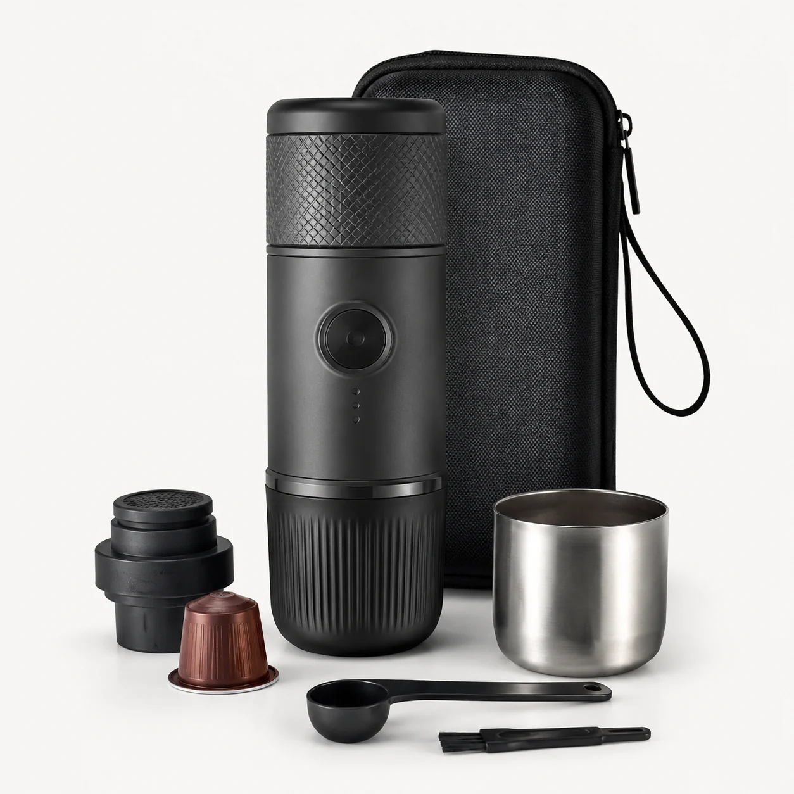
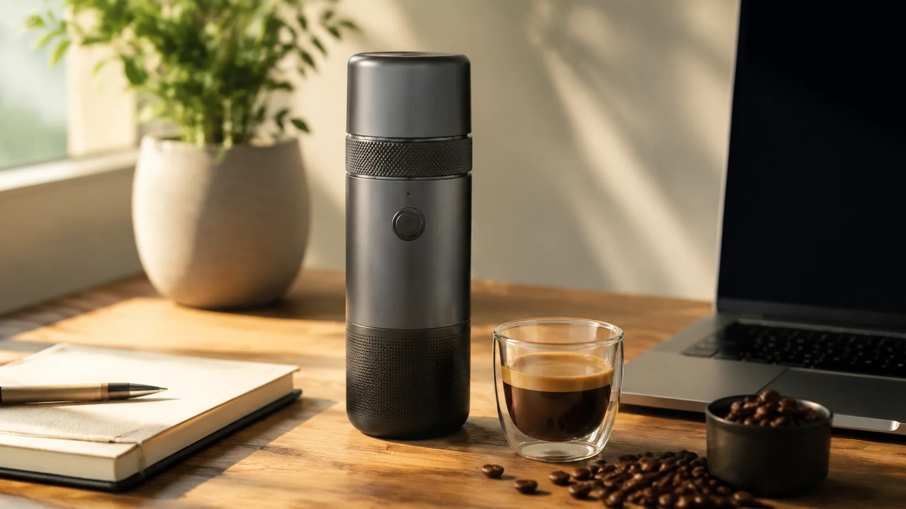

# SuaCanvas · 素画

[中文](README.md) · **日本語** · [English](README.en.md)

**1 枚の商品参考画像から、EC 向けの商品画像セットへ。**

[](openImage/pom.xml)
[](openImage-ts/package.json)
[](#クイックスタート)
[](#ライセンス)

SuaCanvas は、セルフホストできる **AI 商品画像制作ワークスペース**です。商品情報と参考画像をもとに、メイン画像、利用シーン、訴求ポイント、詳細画像をまとめて制作。テンプレート、プロジェクト、生成履歴を再利用しながら、商品動画やキャンバスでの制作にも取り組めます。

*Self-hosted AI studio for ecommerce product image sets and creative workflows.*

[画像サンプル](#画像サンプル) · [主な機能](#主な機能) · [クイックスタート](#クイックスタート) · [文書一覧](docs/README.md)

## SuaCanvas でできること

- **商品単位で制作を整理**：商品情報、参考画像、画像の制作指示、生成結果を同じプロジェクトで管理できます。
- **EC に必要な画像をまとめて制作**：商品外観、使用シーン、特徴、細部など、用途に応じた画像を用意できます。
- **素材と制作手順を再利用**：テンプレートと過去のタスクを活用して、同じ情報を整理し直す手間を減らせます。
- **自分の環境で運用・拡張**：ユーザー画面、管理画面、バックエンドのソースを含み、対応するモデル API やストレージを設定できます。

### 基本の流れ

**商品情報と参考画像を登録 → シーンやテンプレートを選択 → コピーと制作指示を確認 → 生成を実行 → 結果を確認・ダウンロード**

旧プロジェクト名は **OpenImage / PicPilot** です。ディレクトリ名、環境変数、一部の画面には旧名称が残っています。モデル API の接続先、モデル名、認証情報は利用者自身で設定します。

## 画像サンプル

ポータブルコーヒーメーカーを題材にした、リポジトリ同梱の商品素材サンプルです。

| 商品の外観を伝える | 使用シーンを伝える |
| :---: | :---: |
|  |  |

## 主な機能

| 機能 | 内容 |
| --- | --- |
| EC 商品画像セット | メイン画像、シーン画像、訴求画像、詳細画像、比較画像の生成タスクを作成。中国国内 EC と越境 EC のワークフローに対応。 |
| 商品企画・コピー | 商品情報、タイトル、訴求ポイントを整理し、画像の制作指示を作成。商品情報を確認してから画像セットや詳細コンテンツを制作。 |
| 画像 Agent・自由制作 | テキスト、複数の参考画像、テンプレートの意図を組み合わせて生成タスクを構成。プロンプトの改善や制作会話にも対応。 |
| テンプレート | 用途、販売プラットフォーム、商品カテゴリ、キーワードから画像・コピーのテンプレートを検索。 |
| 商品動画 | スクリプトの作成・改善、モデルと仕様の選択、生成タスクの送信、進捗と履歴の確認。対応する動画 API の設定が必要。 |
| タスク・素材管理 | プロジェクトと生成履歴の確認、結果のダウンロード、失敗タスクの再試行、ポイントの消費・返金状況の確認。 |
| 運用管理 | ユーザー、ポイント、引換コード、注文、通知、生成タスク、モデル、プロンプト、コスト、監査記録を管理。 |
| オプションのキャンバス | Nova Image Studio / Infinite Canvas を使った制作と素材整理。別途有効化と AGPL ライセンスへの対応が必要。 |

EC 運営者、デザイナー、コンテンツ制作チーム、自社向け AI サービスを構築したい開発者を想定しています。生成結果、とくに商品の外観、仕様、画像内の文字、広告表現は人が確認してください。

## 構成

バックエンドは **Java 17 / Spring Boot 3 / MyBatis-Plus**、ユーザー画面と管理画面は **Next.js 14 / React / TypeScript**。データとタスクには PostgreSQL / Redis、ファイル保存にはローカルストレージまたは MinIO / S3 互換ストレージを利用します。

```text
openImage/                バックエンド API、生成タスク、課金、DB マイグレーション
openImage-ts/             ユーザー向け Web アプリ
openImage-admin-ts/       管理画面
clients/                 Android / Windows クライアントのソース
canvas-lab/              オプションのキャンバス連携・ビルド設定
third_party/             サードパーティのソースとライセンス
scripts/                 設定生成、管理者初期化、ビルド・配布用ツール
docs/                    機能・運用・ライセンスの詳細
docker-compose.yml       ローカルのコンテナ構成
```

## クイックスタート

**新規環境向けの手順です。** Git、Python 3、Docker Engine / Docker Desktop（Linux コンテナ）、Docker Compose v2 を用意してください。ホスト側に Java、Node.js、PostgreSQL、Redis をインストールする必要はありません。初回はインターネット接続が必要で、イメージと依存関係を取得してアプリをビルドします。

### 1. ソースとローカル設定を用意

```bash
git clone https://github.com/suakitsu/suacanvas.git
cd suacanvas
python scripts/init-local-env.py
```

環境に応じて `python` を `python3` に置き換えてください。Windows PowerShell でも各行を実行できます。

設定ツールは `.env` を作成し、DB、JWT、オブジェクトストレージ、設定暗号化用の独立したランダム値を生成します。既存ファイルは上書きしません。稼働中の環境では既存の秘密値を保持し、新しい値で置き換えないでください。

### 2. Web アプリを起動

リポジトリのルートで実行します。

```bash
docker compose up -d --build
docker compose ps
```

DB、Redis、オブジェクトストレージ、バックエンド、ユーザー画面、管理画面が対象です。Web 画面はバックエンドのヘルスチェック成功後に起動します。DB マイグレーションはバックエンドが実行します。

### 3. 最初の管理者を作成

バックエンドの準備ができたら、対話型のターミナルで実行します。

```bash
python scripts/bootstrap-admin.py
```

自分のメールアドレスとパスワードを入力してください。このツールはマイグレーション完了後、有効な管理者がまだ存在しない場合に限り、最初の管理者を作成します。既存アカウントを上書きしません。

パスワードは標準入力で、ネットワークを無効にした公式 `httpd:2.4-alpine` ツールコンテナへ渡し、bcrypt ハッシュを生成します。DB に渡すのはハッシュのみです。初回はツールイメージの取得が必要になる場合があります。追加の Python パッケージは不要です。

初期ポイントは 0 です。管理画面でモデルを設定し、必要に応じて利用アカウントにポイントを割り当ててください。オンラインの管理者登録は無効で、共通の初期パスワードもありません。`ADMIN_INVITE_CODE` の設定は不要です。

| サービス | 既定のアクセス先 |
| --- | --- |
| ユーザー画面 | `http://127.0.0.1:13000` |
| 管理画面 | `http://127.0.0.1:13001` |
| バックエンドの状態確認 | `http://127.0.0.1:18080/api/public/ping` |
| MinIO コンソール | `http://127.0.0.1:19001` |

ポートを変更した場合は `.env` の設定に従ってください。ログ確認には `docker compose logs --tail=100 backend user-web admin-web` を利用できます。

### 画像生成とユーザー登録を有効化

基本サービスの起動自体にはモデル API Key は不要です。実際の画像生成、動画、決済、外部ログインは既定で無効です。`.env` または対応する管理画面で自分のサービスを設定してください。API 利用料金は各プロバイダーから請求されます。

| 用途 | 設定 |
| --- | --- |
| 画像生成 | `OPENIMAGE_AI_IMAGE_ENABLED=true` と、同プレフィックスの `PROVIDER`、`BASE_URL`、`KEY`、`MODEL`。既存アダプターに対応する API を使用。 |
| コピー生成 | `OPENIMAGE_AI_TEXT_DEEPSEEK_ENABLED` と、同プレフィックスの `BASE_URL`、`KEY`、`MODEL`。 |
| 商品動画 | `VIDEO_PAID_PROVIDER_ENABLED` と、利用する動画プロバイダーの認証情報・仕様。 |
| メールによる一般ユーザー登録 | `TENCENT_SES_SECRET_ID`、`TENCENT_SES_SECRET_KEY`、`TENCENT_SES_FROM_EMAIL`、`TENCENT_SES_TEMPLATE_ID`、リージョン。未設定では登録用の確認コードを送信できません。 |
| GitHub ログイン | `GITHUB_LOGIN_ENABLED`、OAuth Client ID / Client Secret、正しいコールバック URL。 |
| ファイル保存 | 既定は `STORAGE_PROVIDER=local`。MinIO を使う場合は認証情報と利用者からアクセスできる公開 URL も設定。 |

バックエンドの `.env` を変更したら `docker compose up -d backend` でコンテナを更新します。`NEXT_PUBLIC_*` を変更した場合は `docker compose up -d --build user-web admin-web` でフロントエンドも再ビルドしてください。実際の `.env`、API Key、DB バックアップ、ユーザーのアップロードを Git に追加しないでください。

### サーバーへの導入

`.env` の `NEXT_PUBLIC_API_BASE_URL`、`USER_WEB_BASE_URL`、`ALLOWED_ORIGINS` を実際の公開ドメインとポートに変更します。リモートの利用者に `127.0.0.1` を参照させないでください。`OPENIMAGE_AI_IMAGE_PUBLIC_BASE_URL` と `VIDEO_PUBLIC_BASE_URL`、必要に応じて Worker / オブジェクトストレージの公開 URL も設定します。

公開運用では HTTPS とリバースプロキシを設定し、管理画面へのアクセスを信頼できる範囲に制限してください。停止には `docker compose down` を使用できます。データを保持する場合は `-v` を付けないでください。

### 導入時の補足

- キャンバスとクライアントは追加設定が必要です。既定の Compose は Web アプリを起動します。[キャンバスのソース・配布手順](docs/canvas-source.md)と[クライアントのビルド手順](docs/client-release.md)を参照してください。
- 既存 DB の更新には過去のマイグレーションのチェックサムと暗号化設定の確認が必要です。[安全な設定と移行](docs/security-and-publication.md)を確認し、根拠なく Flyway `repair` を実行しないでください。
- この導入手順はソースをもとに静的確認しています。今回、イメージのビルド、コンテナ起動、管理者作成、DB 移行の実行テストは行っていません。実際の動作は導入先で確認してください。

## ドキュメント

| 文書 | 内容 |
| --- | --- |
| [中文 README](README.md) / [English README](README.en.md) | 他の言語による説明と導入手順 |
| [セキュリティと移行](docs/security-and-publication.md) | 秘密値、管理者、既存 DB の更新 |
| [クライアント配布](docs/client-release.md) | Android / Windows のビルドと配布 |
| [キャンバスの対応ソース](docs/canvas-source.md) | 固定した上流バージョンとソース提供 |
| [文書一覧](docs/README.md) | その他のガイド |

## ライセンス

SuaCanvas 独自のオリジナルコードは [MIT](LICENSE) です。Nova Image Studio / Infinite Canvas とその派生部分は **AGPL-3.0** を維持します。ルートの MIT ライセンスがサードパーティ部分のライセンス上の義務を取り除くものではありません。

Noto Sans CJK フォントは **OFL-1.1** です。その他の依存関係、素材、商標はそれぞれのライセンスと告知に従います。[サードパーティ告知](THIRD_PARTY_NOTICES.md)、[素材について](ASSET_NOTICE.md)、[対応ソースの提供手順](docs/canvas-source.md)も確認してください。
