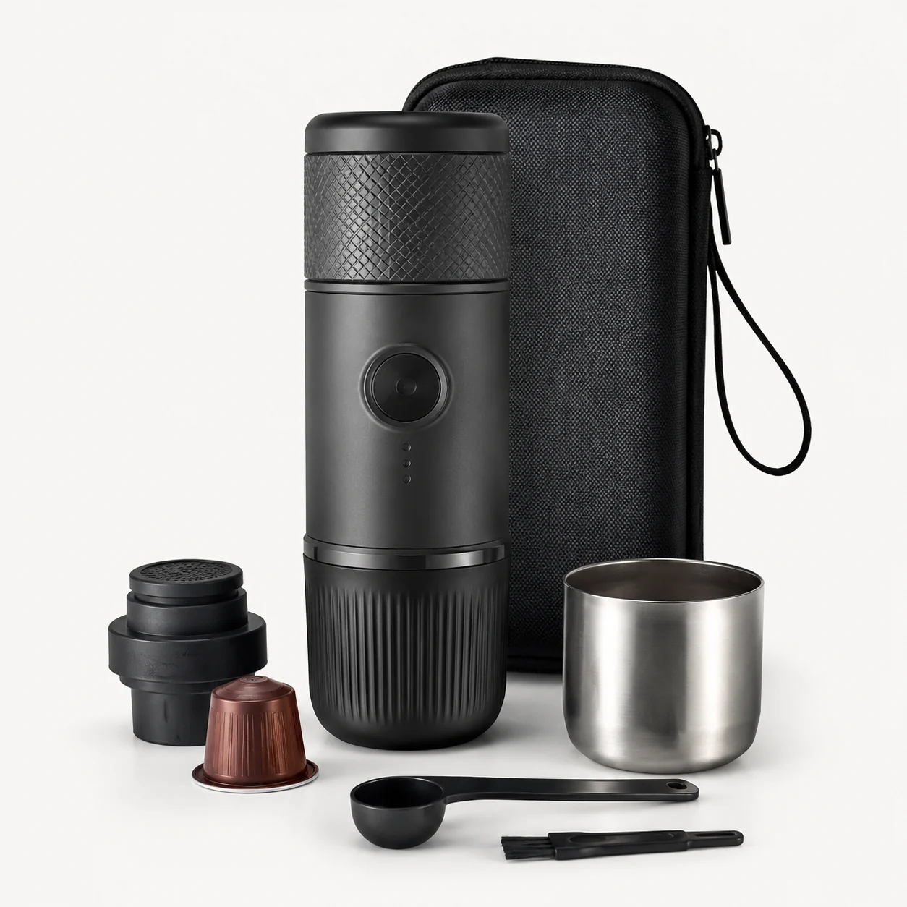
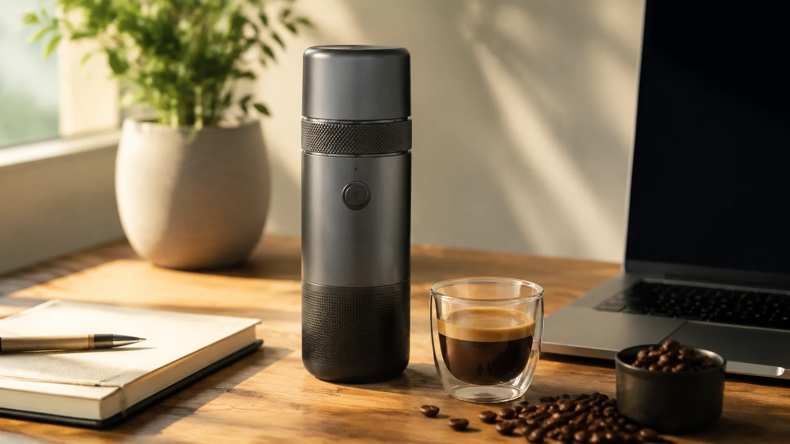

# SuaCanvas · 素画

**中文** · [日本語](README.ja.md) · [English](README.en.md)

**从一张商品参考图，开始制作一整套电商图片。**

[](openImage/pom.xml)
[](openImage-ts/package.json)
[](#本地部署)
[](#许可证)

SuaCanvas 是一个可自部署的 **AI 电商商品套图工作台**。围绕同一份商品资料与参考图，制作主图、场景图、卖点图和细节图；通过模板、项目与历史记录复用素材，也能继续创作商品视频和画布内容。

*Self-hosted AI studio for ecommerce product image sets and creative workflows.*

[查看效果](#素材示例) · [了解功能](#功能介绍) · [快速部署](#本地部署) · [文档目录](docs/README.md)

## 为什么用 SuaCanvas

- **围绕商品组织创作**：商品信息、参考图、图片 Brief 和生成结果放在同一项目中，便于迭代与交付。
- **覆盖整套电商图片**：围绕商品外观、使用场景、卖点与细节组织素材，并支持商品视频创作。
- **复用已有经验**：通过模板、参考图和历史任务积累内容制作流程，减少重复整理。
- **支持独立部署与二次开发**：用户端、管理端和后端源码齐全，可接入兼容的模型 API 与存储服务。

### 从一个商品开始

**上传参考图与商品资料 → 选择场景或模板 → 确认文案 / Brief → 提交生成 → 下载并检查结果**

仓库包含用户网站、管理后台、Java 后端，以及 Android / Windows 客户端工程。项目原名 **OpenImage / PicPilot**，内部目录、环境变量与部分界面沿用原名称。模型能力通过外部 API 接入，部署者需要自行配置服务地址、模型和凭据。

## 素材示例

以便携咖啡机为例，展示同一商品的主图与使用场景素材。以下为仓库内置素材示例。

| 展示商品外观 | 展示使用场景 |
| :---: | :---: |
|  |  |

## 功能介绍

| 能力 | 可以做什么 |
| --- | --- |
| 电商商品套图 | 上传商品图和参考图，围绕主图、场景图、卖点图、细节图与对比图创建生成任务；支持国内电商和跨境电商工作流。 |
| 商品策划与文案 | 整理商品信息、标题与卖点，生成图片制作方案；确认商品事实后，继续制作套图和详情内容。 |
| 图片 Agent 与自由创作 | 结合文字描述、多张参考图和模板意图组织图片任务，支持 Prompt 优化与创意会话。 |
| 模板中心 | 按场景、平台、类目和关键词查找图片与文案模板，覆盖 3C 数码、家电、服饰及通用电商素材。 |
| 商品视频 | 编写或优化视频脚本，选择可用模型与规格，提交任务并查看进度、结果和历史；需要配置支持的视频供应商。 |
| 任务与素材管理 | 查看项目和生成历史，下载结果、重试失败图片，跟踪任务状态、扣费和退款。 |
| 积分与运营后台 | 管理用户、积分流水、兑换码、充值订单、站内信、图片/视频任务、成本、Prompt、模型配置和审计记录。 |
| 可选画布 | 集成 Nova Image Studio 与 Infinite Canvas，用于进一步创作与素材组织；需要单独启用，并遵守对应的 AGPL 许可。 |

### 适用场景

- **电商卖家与运营人员**：围绕同一商品准备不同用途的图片、文案和视频素材。
- **设计与内容团队**：复用模板、参考图和项目资料，集中查看任务与交付结果。
- **开发者与平台运营者**：基于现有账号、任务、存储、积分和管理模块，搭建自己的 AI 内容服务。

## 使用流程

1. **建立项目**：填写商品信息，上传商品图与参考图，选择目标场景或模板。
2. **确认内容**：检查生成的文案、商品事实、图片 Brief 或视频脚本。
3. **提交生成**：选择已配置的模型和规格，确认积分后提交任务。
4. **查看与交付**：在项目详情或历史记录中查看进度、下载素材，按需重试失败任务。

模型生成结果需要人工检查，尤其是商品外观、参数、图内文字和宣传内容。实际能力与效果取决于输入素材、模型及供应商支持。

## 项目结构

后端采用 **Java 17 / Spring Boot 3 / MyBatis-Plus**，用户端与管理端采用 **Next.js 14 / React / TypeScript**。数据与任务依赖 PostgreSQL、Redis；文件可使用本地存储或 MinIO / S3 兼容存储。

```text
openImage/                后端 API、生成任务、计费、存储与数据库迁移
openImage-ts/             用户网站与创作工作台
openImage-admin-ts/       运营管理后台
clients/                 Android 与 Windows 客户端工程
canvas-lab/              可选画布的代理、构建与集成配置
third_party/             第三方源码、许可证及上游说明
scripts/                 配置初始化、构建、发布与源码导出工具
docs/                    功能、部署、安全和许可证文档
docker-compose.yml       本地容器编排
```

## 本地部署

以下步骤面向**新建环境**。准备 Git、Python 3、Docker Engine / Docker Desktop（Linux 容器模式）和 Docker Compose v2；无需在宿主机另装 Java、Node.js、PostgreSQL 或 Redis。首次运行需要联网下载镜像与依赖，并在本机构建应用镜像。

### 1. 获取代码并生成私有配置

```bash
git clone https://github.com/suakitsu/suacanvas.git
cd suacanvas
python scripts/init-local-env.py
```

如果系统使用 `python3` 命令，将文中的 `python` 替换为 `python3`。Windows PowerShell 也可以按行执行这些命令。

脚本会生成 `.env`，为数据库、JWT、对象存储和配置加密创建随机密钥，并拒绝覆盖已有文件。已有部署应保留原有配置，核对缺少的字段；不要重新生成密钥覆盖旧值。

### 2. 启动 Web 平台

在仓库根目录执行：

```bash
docker compose up -d --build
docker compose ps
```

Compose 启动数据库、Redis、对象存储和三个应用服务。用户端与管理端会等待后端健康检查通过后启动。数据库迁移由后端自动执行；已有数据库升级须先阅读下方迁移说明。

### 3. 初始化首个管理员

后端就绪后，在本机交互式终端运行：

```bash
python scripts/bootstrap-admin.py
```

按提示输入自己的邮箱和密码。脚本仅在没有有效管理员、数据库迁移完成时创建首个管理员，不覆盖已有账号。密码通过标准输入交给隔离网络的官方 `httpd:2.4-alpine` 工具容器计算 bcrypt 哈希；数据库仅接收哈希。首次执行可能下载工具镜像，不需要安装额外 Python 包。

管理员初始积分为 0。登录后台后，配置模型服务，并按需为使用账号分配积分。当前不开放在线管理员注册；无需设置 `ADMIN_INVITE_CODE`，也没有共享默认管理员密码。

使用示例配置时，访问地址如下；修改端口后，以自己的 `.env` 为准。

| 服务 | 默认地址 |
| --- | --- |
| 用户端 | `http://127.0.0.1:13000` |
| 管理端 | `http://127.0.0.1:13001` |
| 后端健康检查 | `http://127.0.0.1:18080/api/public/ping` |
| MinIO 控制台 | `http://127.0.0.1:19001` |

排查启动状态可运行 `docker compose logs --tail=100 backend user-web admin-web`。修改 `NEXT_PUBLIC_*` 前端构建参数后，需要重新构建相关前端镜像。

### 启用生图与用户注册

基础平台启动不需要模型 API Key。真实生图、视频、支付和第三方登录默认关闭；使用前在 `.env` 或对应后台配置中接入自己的服务。模型调用费用由供应商收取。

| 要启用的能力 | 需要配置什么 |
| --- | --- |
| 图片生成 | `OPENIMAGE_AI_IMAGE_ENABLED=true`，以及 `OPENIMAGE_AI_IMAGE_PROVIDER`、`OPENIMAGE_AI_IMAGE_BASE_URL`、`OPENIMAGE_AI_IMAGE_KEY`、`OPENIMAGE_AI_IMAGE_MODEL`；供应商需符合现有适配器协议。 |
| 文案生成 | `OPENIMAGE_AI_TEXT_DEEPSEEK_ENABLED` 及同前缀的 `BASE_URL`、`KEY`、`MODEL`。 |
| 商品视频 | `VIDEO_PAID_PROVIDER_ENABLED`、所选视频供应商的凭据与规格配置。 |
| 普通用户邮箱注册 | `TENCENT_SES_SECRET_ID`、`TENCENT_SES_SECRET_KEY`、`TENCENT_SES_FROM_EMAIL`、`TENCENT_SES_TEMPLATE_ID` 和区域；未配置邮件时无法发送注册验证码。 |
| GitHub 登录 | 启用 `GITHUB_LOGIN_ENABLED`，配置 OAuth Client ID、Client Secret 及正确的回调地址。 |
| 文件存储 | 默认 `STORAGE_PROVIDER=local`；使用 MinIO 时配置凭据和用户可访问的文件地址。 |

修改后端 `.env` 配置后运行 `docker compose up -d backend` 重建对应容器；修改前端公开变量时运行 `docker compose up -d --build user-web admin-web`。不要把真实 `.env`、密钥、数据库备份或用户上传提交到 Git。

### 部署到服务器

先把 `.env` 中的 `NEXT_PUBLIC_API_BASE_URL`、`USER_WEB_BASE_URL`、`ALLOWED_ORIGINS` 改为用户实际访问的域名与端口；不能让远程用户继续请求 `127.0.0.1`。同时设置 `OPENIMAGE_AI_IMAGE_PUBLIC_BASE_URL`、`VIDEO_PUBLIC_BASE_URL`，使用 Worker 或对象存储时还需设置其公开地址。

公开服务应配置 HTTPS 和反向代理，管理端限制到受信任的访问范围。依赖服务与数据卷由 Compose 管理；停止应用可使用 `docker compose down`，需要保留数据时不要添加 `-v`。

### 部署前须知

- 画布与客户端需要额外配置。默认 Compose 启动 Web 平台，画布见[源码与部署说明](docs/canvas-source.md)；客户端构建见[发布文档](docs/client-release.md)。
- 现有数据库升级涉及历史迁移校验和与配置加密兼容性，请先阅读[安全与迁移说明](docs/security-and-publication.md)，不要直接覆盖旧库或盲目执行 Flyway `repair`。
- 部署步骤已按源码进行静态核对；本轮未执行镜像构建、容器启动、管理员创建或数据库迁移测试，实际运行结果需在目标环境确认。

## 文档导航

| 文档 | 内容 |
| --- | --- |
| [日本語 README](README.ja.md) | 日语项目介绍与快速部署 |
| [English README](README.en.md) | 英文项目介绍与部署入口 |
| [安全与迁移说明](docs/security-and-publication.md) | 私有配置、管理员、旧数据库升级与发布注意事项 |
| [客户端发布](docs/client-release.md) | Android / Windows 客户端构建和发布 |
| [画布对应源码](docs/canvas-source.md) | 固定上游版本、构建和对应源码交付 |
| [文档目录](docs/README.md) | 更多文档入口 |

## 许可证

SuaCanvas 自有原创代码采用 [MIT](LICENSE)。仓库同时包含或集成 **AGPL-3.0** 的 Nova Image Studio 与 Infinite Canvas，这些部分及其派生修改保留原许可；根目录 MIT 不消除组合应用适用的第三方许可义务。

Noto Sans CJK 字体使用 **OFL-1.1**。其他依赖、演示素材与商标分别遵循对应许可和声明。使用、修改或分发前，请阅读[第三方许可说明](THIRD_PARTY_NOTICES.md)、[素材说明](ASSET_NOTICE.md)和[对应源码交付流程](docs/canvas-source.md)。
